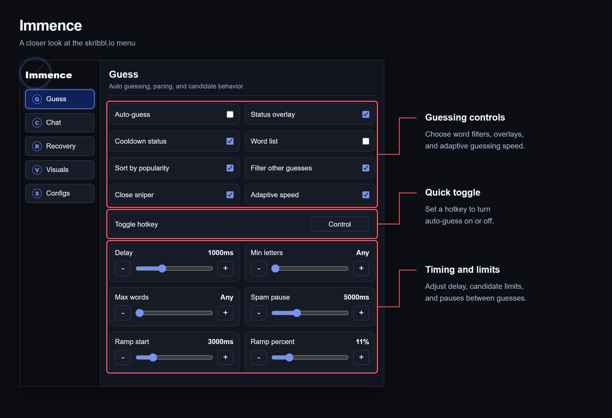

# Immence

Immence is a Chrome extension for skribbl.io that brings guessing tools and game customization into one compact menu. It includes automatic guessing, adjustable pacing, word filtering, status overlays, chat controls, reconnect and requeue options, custom colors, and saved configurations.

To install, download and extract this repository, open `chrome://extensions`, enable Developer mode, and choose **Load unpacked** with the folder containing `manifest.json`. Open skribbl.io and click the Immence icon to configure the extension. Auto-guess starts disabled; use the menu or your configured hotkey to turn it on.

